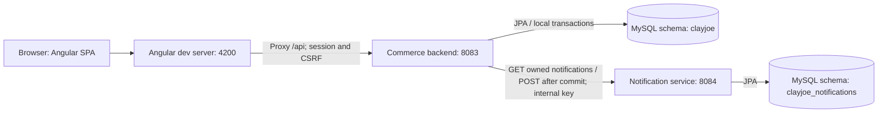
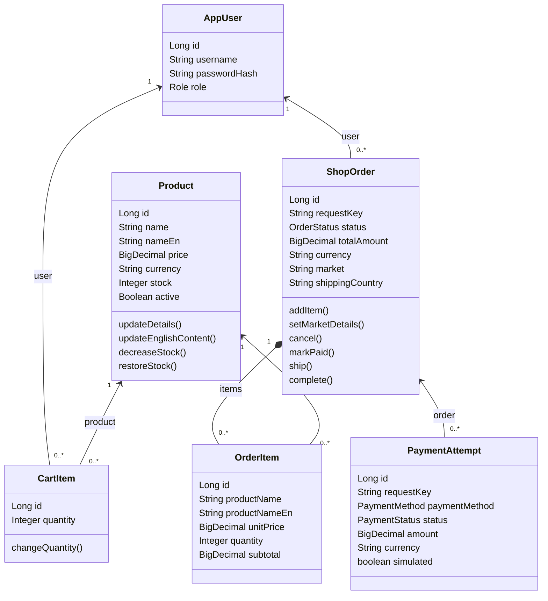
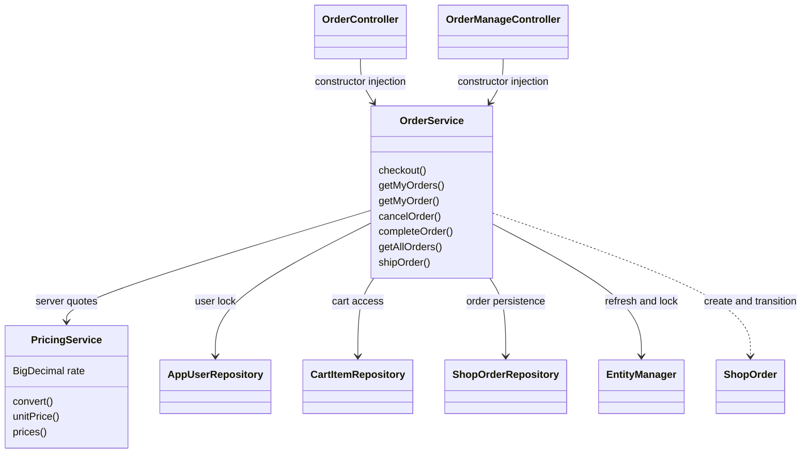
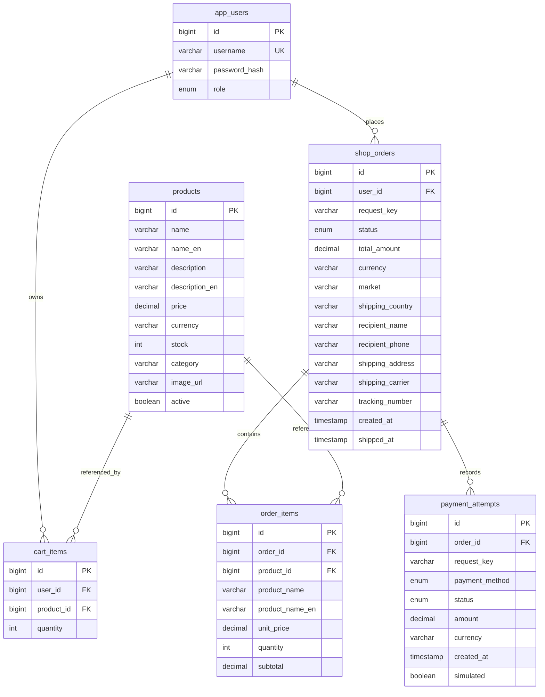
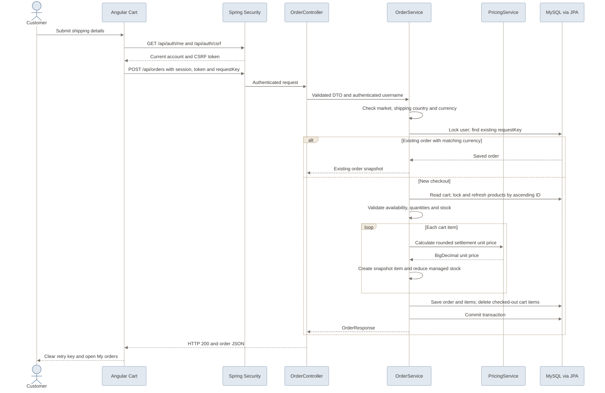
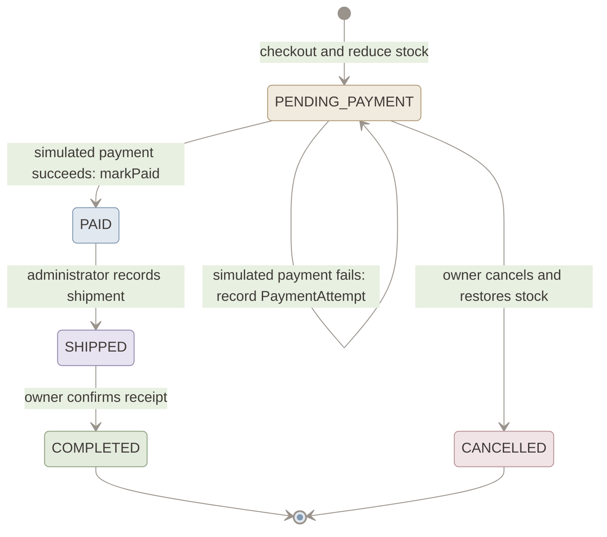

# CLAYJOE Technical Document

| Document information | Value |
| --- | --- |
| Course / project | IN6206 / CLAYJOE Handmade Ceramics Store |
| Deliverable | Technical Document |
| Version / baseline | 1.1 / 13 November 2026 |
| Companion | [Functional Document v1.2](CLAYJOE_Functional_Document_EN.md) |
| Evidence | Current backend and frontend source; learner-reported focused test and browser acceptance results |

## 1. Purpose, Scope and Evidence

This document explains how the implemented single-merchant store works. It covers architecture, classes, data relationships, interfaces, security, transactions, pricing, deployment and verification. The application supports customers and administrators, two interface languages and two shipping markets within one shared system.

Descriptions are based on source inspection on the baseline date. Database diagrams and field types describe JPA mappings, not a fresh export of the live MySQL schema. The database dump remains a separate deliverable. Diagrams use Mermaid embedded in Markdown; the six editable `.mmd` sources are supplied in `technical-diagrams/`. A Mermaid-capable viewer is needed to render them. 

## 2. Technology Baseline

| Layer | Observed choice | Purpose |
| --- | --- | --- |
| Frontend | Angular 22.2.3, TypeScript 6.0.3 | Standalone components, routing, forms and typed page logic |
| Reactive requests | RxJS 7.8.2 | HTTP request composition and error handling |
| Frontend tests | Vitest 5.0.5; Angular HTTP testing utilities | Isolated service/component-logic tests |
| Backend | Java 21; Spring Boot parent 4.1.1; Maven wrapper | Application bootstrap and dependency management |
| Web / security | Spring MVC, Spring Security, Jakarta Validation | REST endpoints, sessions, permissions and input validation |
| Persistence | Spring Data JPA, Hibernate, MySQL Connector/J | Repository access and object-relational mapping |
| Database | MySQL 8.4 series; 8.4.11 in previously supplied runtime output | Relational storage and transaction/row-lock support |
| Backend tests | JUnit Jupiter and Mockito | Business-rule tests with mocked repositories |

Frontend exact versions above come from `package-lock.json`; `package.json` declares ranges. Backend library versions are managed by the Spring Boot parent rather than independently pinned in this document. The MySQL patch version was not re-queried during this documentation task.

## 3. Architecture and Deployment Boundaries

Angular provides the browser interface; Spring MVC returns JSON rather than rendering Thymeleaf pages. A single Spring Boot application contains the controller, business-service and persistence layers. All six commerce entities use the same database. The independent notification service uses a separate schema. The CN/SG selection is a business setting, not a separate deployment or separate inventory.



**Figure 1. Local runtime architecture.** Port 4200 serves the frontend and proxies `/api/**` to port 8083; backend JDBC connections reach MySQL on port 3306. Product images are frontend static assets, not database binary objects. The payment module performs local simulation and has no connection to external payment providers. Docker, Kafka and a separate API gateway are not part of this implementation.

A layered monolith keeps checkout and stock changes inside one database transaction and avoids distributed deployment overhead. Constructor injection makes dependencies explicit and replaceable in tests. Controllers translate HTTP input, services enforce rules, entities retain state and invariants, and repositories encapsulate persistence. DTOs control the JSON contract and avoid exposing password hashes or directly serialising entity relationships.

## 4. Frontend Organisation

| Route | Component | Responsibility |
| --- | --- | --- |
| `/` | ProductList | Published catalogue and category filtering |
| `/products/:id` | ProductDetail | Product content, gallery and cart entry |
| `/login`, `/register` | Login, Register | Session login and customer registration |
| `/cart` | Cart | Quantities, regional estimate, delivery input and checkout |
| `/orders`, `/orders/:id` | Orders, OrderDetail | Owned orders, payment simulation and lifecycle actions |
| `/manage/products` | ProductManage | Administrator catalogue and publication state |
| `/products/new`, `/products/:id/edit` | ProductCreate, ProductEdit | Product forms and bilingual content |
| `/manage/orders` | OrderManage | Store-wide orders and shipment recording |

`adminGuard` protects the four administrator routes by requesting `/api/auth/me`. It improves navigation behaviour; backend permissions remain the security boundary. Customer pages handle unauthenticated API responses rather than all using a route guard. Specific creation/edit routes are declared before the generic product-detail route.

`LanguageService` stores text selection independently of `MarketService`. Signals hold current user, language, market and page state; computed values derive currency and cart totals. Angular `HttpClient` and RxJS handle requests. Product forms use reactive forms; cart shipping fields use `FormsModule` bindings. `AdminTextService` and `OrderTextService` centralise relevant display labels. `catalog-gallery.ts` holds configured additional image paths; gallery configuration is not a database entity.

The frontend `PricingService` selects a backend-provided quote; it does not set the authoritative checkout amount. The CSRF interceptor is registered once through `app.config.ts`.

## 5. Backend Classes and Responsibilities

| Package / class | Responsibility and reason |
| --- | --- |
| `BackendApplication` | Starts Boot and component scanning under `com.clayjoe.backend`. |
| `controller/*` | HTTP mappings, `@Valid` request validation and authenticated identity forwarding. |
| `ProductService` | Catalogue reads, creation, locked edits and publication changes. |
| `CartService` | User-owned cart operations; user locks serialise cart writes with checkout. |
| `OrderService` | Checkout, owner-scoped reads, cancellation, shipment and receipt transitions. |
| Backend `PricingService` | Configurable decimal currency conversion and quote generation. |
| `AuthService` | Username normalisation, password byte-length check, hashing and registration. |
| `DatabaseUserDetailsService` | Loads stored credentials and roles into Spring Security. |
| `PaymentService` | Owner-scoped, idempotent payment simulation, enabled only in the demo profile. |
| `repository/*` | Five `JpaRepository` interfaces; custom owner-scoped queries and pessimistic locks. |
| `dto/*` | Request/response records separating API fields from persistence objects. |
| `ApiExceptionHandler` | Maps Bean Validation failures into a field-error response. |
| `SecurityConfig`, `PasswordConfig` | `@Bean` definitions for the filter chain and BCrypt password encoder. |

### 5.1 Domain Class Diagram



**Figure 2. Selected domain members and associations.** Getters, constructors and some shipping/text fields are omitted for readability. `ShopOrder.items` uses `cascade = PERSIST`; this is not a claim of database cascade deletion. Zero items are possible while constructing an object or in the structural schema, but successful checkout requires a non-empty cart and creates at least one item. There is no separate `Cart` entity: cart rows reference the user directly. `OrderItem` has no standalone repository; it is persisted through the order.

### 5.2 Checkout Service Dependencies



**Figure 3. Constructor-injected checkout dependencies.** The two order controllers reuse one service. `EntityManager.refresh(..., PESSIMISTIC_WRITE)` both reloads a managed entity and locks its database row; repository access alone would not guarantee that previously loaded stock is refreshed.

## 6. Database Design

### 6.1 Entity Relationship Diagram



**Figure 4. Six business tables.** Cardinalities show structural relationships; business checkout requires at least one order item. `timestamp` labels denote time values represented as Java `Instant`, not a verified physical MySQL column type. Earlier supplied DDL used `datetime(6)` for order creation time. 

### 6.2 Data Dictionary and Constraints

All entity IDs are generated `Long` identities, normally mapped to auto-increment `BIGINT`. 

| Table | Important mapped fields and constraints |
| --- | --- |
| `app_users` | `username`: required, unique, length 50; `password_hash`: required, length 255; `role`: required string enum USER/ADMIN. |
| `products` | `name`, `name_en`: length 255; descriptions: length 2000; `price`: DECIMAL(10,2); `currency`: length 3; `stock`: Integer; `category`: length 30; `image_url`: length 500; `active`: Boolean. Most columns are nullable in the entity mapping even though request DTOs require valid inputs. New entities default to SGD and active=true; legacy null currency is read as CNY by the getter. These are Java defaults, not promised database defaults. |
| `cart_items` | Required user/product foreign keys and quantity; composite unique constraint `uk_cart_user_product(user_id, product_id)` keeps one row per product per user. |
| `shop_orders` | Required user FK, request key length 36, status, DECIMAL(19,2) total, currency length 3 and creation time; unique `uk_order_user_request(user_id, request_key)`. Optional shipping fields: recipient 100, phone 30, address 500, carrier/tracking 100 each, shipment time. `market`/`shipping_country` length 2 are nullable for earlier orders and marked `updatable=false`. |
| `order_items` | Required order/product FKs, product-name snapshot length 255, optional English-name snapshot length 255; required DECIMAL(19,2) unit price/subtotal and quantity. Older DDL may still show DECIMAL(10,2) for unit price; check the final dump. |
| `payment_attempts` | Required order FK, request key length 36, method/status string enums, DECIMAL(19,2) amount, currency length 3, creation time and simulated flag; unique `uk_payment_order_request(order_id, request_key)`. |

### 6.3 Why These Relationships Exist

A user can own many cart rows and orders; a product can appear in many carts and order items. An order contains purchase snapshots and may have multiple payment attempts because a failed simulation can be followed by a successful attempt. Orders and payments retain amounts rather than recalculating historical purchases from current products.

Bilingual order names are copied when the item is created. Product edits therefore do not rewrite purchase history. Products are unpublished instead of removed through a public delete API, preserving references. Category and role are fields/enums, not extra lookup tables. Additional image galleries and market/language preferences are not stored in separate business tables. Currency is stored on the order, so all its items share one settlement currency.

## 7. REST Interface Contract

Paths below are backend API paths, not Angular page routes. “Owner” means the username comes from Spring Security and records are looked up with the corresponding user ID. Login is form-encoded; other write payloads below are JSON. All modifying API requests require CSRF protection, including public registration/login. Success status codes reflect the current controllers.

| Method | Path | Access | Success / purpose |
| --- | --- | --- | --- |
| GET | `/api/health` | Public | 200, basic application health response |
| GET | `/api/auth/csrf` | Public | 200, token and header name |
| POST | `/api/auth/register` | Public | 201, customer account |
| POST | `/api/auth/login` | Public | 200, session login; handled by security filter |
| POST | `/api/auth/logout` | Session operation | 204, session logout; security filter |
| GET | `/api/auth/me` | Signed in | 200, username and authorities |
| GET | `/api/products?category=...` | Public | 200, published products with quotes |
| GET | `/api/products/{id}` | Public | 200, published detail |
| GET | `/api/products/manage` | ADMIN | 200, complete catalogue |
| GET | `/api/products/manage/{id}` | ADMIN | 200, editable product |
| POST | `/api/products` | ADMIN | 201 with Location, create product |
| PUT | `/api/products/{id}` | ADMIN | 200, edit product |
| PATCH | `/api/products/{id}/status` | ADMIN | 200, change publication state |
| GET | `/api/cart` | Owner | 200, cart rows and quotes |
| POST | `/api/cart/items` | Owner | 200, add `{productId, quantity}` |
| PUT | `/api/cart/items/{itemId}` | Owner | 200, update `{quantity}` |
| DELETE | `/api/cart/items/{itemId}` | Owner | 204, remove row |
| POST | `/api/orders` | Owner | 200, checkout or existing request result |
| GET | `/api/orders` | Owner | 200, own order list |
| GET | `/api/orders/{id}` | Owner | 200, own order detail |
| POST | `/api/orders/{id}/cancel` | Owner | 200, cancel eligible order |
| POST | `/api/orders/{id}/complete` | Owner | 200, confirm receipt |
| POST | `/api/orders/{id}/payments/simulate` | Owner; demo profile | 200, recorded simulation result |
| GET | `/api/manage/orders` | ADMIN | 200, store-wide order list |
| POST | `/api/manage/orders/{id}/ship` | ADMIN | 200, `{shippingCarrier, trackingNumber}` |

The product-management path is `/api/products/manage`, while order management uses `/api/manage/orders`

### 7.1 Checkout Payload

```json
{
  "requestKey": "f86f7e2d-dbf0-4cb8-88e6-448b16d0f789",
  "recipientName": "Demo Customer",
  "recipientPhone": "12345678",
  "shippingAddress": "Demo address in Shanghai",
  "currency": "CNY",
  "market": "CN",
  "shippingCountry": "CN"
}
```

This is an illustrative payload, not a real customer record. The frontend supplies no trusted total, exchange rate or user ID. The backend reads the authenticated user's cart and current products. `OrderResponse` contains ID, status, total, currency, creation time, shipping fields, item snapshots, market and shipping country. Product/cart responses additionally contain `prices` keyed by SGD/CNY and `sgdToCnyRate`; legacy `price`/`subtotal` fields represent the base currency and must not be mistaken for the selected market's quote.

### 7.2 Validation and Error Responses

Request records use `@NotBlank`, `@Size`, `@Pattern`, numeric constraints and `@Valid`. Checkout/payment request keys must match UUID format; markets are CN/SG and currencies CNY/SGD. Service checks handle relational rules such as ownership, stock and matching market/currency.

Bean Validation errors return HTTP 400 with `{message, errors}`, where `errors` maps field names to messages. `ResponseStatusException` supplies business status codes, while security failures may have empty bodies; there is no single custom envelope covering every error. Clients must inspect HTTP status instead of assuming every response has `errors`. Typical meanings: 400 invalid input, 401 no valid session, 403 denied role/CSRF, 404 missing or non-owned resource, and 409 business-state conflict. Backend messages are not a fully localised API; frontend text services provide relevant translated user feedback.

## 8. Authentication, Authorisation and CSRF

Registration normalises usernames to lowercase, rejects duplicate usernames and hashes passwords through a BCrypt `PasswordEncoder` bean. The database stores hashes, not recoverable passwords. The service checks the 72-byte UTF-8 bound in addition to DTO character limits. Public registration always creates Role.USER.

Spring Security's form-login filter processes `/api/auth/login` and uses `DatabaseUserDetailsService` to load credentials. Successful login establishes a server-side session carried by the JSESSIONID cookie; this is not JWT authentication. `/api/auth/me` returns username and authorities. Logout ends the session. Cookie security for an eventual HTTPS deployment must be configured separately; local HTTP is the current environment.

The request rules protect product management before broader public product GET patterns, restrict product writes and order management to ADMIN, and require authentication otherwise. Owner queries use the authenticated identity, not a client-supplied user ID. Changing a visible route or hiding a button alone cannot grant backend permission.

For each relative `/api/` POST/PUT/PATCH/DELETE, the Angular interceptor fetches `/api/auth/csrf` and adds the returned header/token before forwarding the request. GET token acquisition bypasses the write branch, avoiding recursion. Fetching a fresh token also accommodates authentication-related token changes. CSRF protection remains enabled. Development proxying presents one browser origin, simplifying cookie handling without a separate cross-origin frontend setup.

## 9. Checkout, Transactions and Retry Handling

### 9.1 Checkout Sequence



**Figure 5. Successful/replayed checkout.** Security and DTO failures stop before business processing. Business exceptions during the transaction roll back database changes; the diagram omits those error branches. The transaction interceptor commits after the service invocation and before the controller returns a successful response. Calling `saveAndFlush` alone is not a commit.

### 9.2 Transaction Design

`OrderService.checkout` is `@Transactional`. It first rejects invalid market/country/currency combinations, then locks the user's row. Cart writes use the same user lock, serialising changes for that account. The service checks `(user_id, request_key)` before checking for an empty cart, because a successful first checkout has already cleared it.

For a new order, cart products are sorted by product ID and refreshed under pessimistic write locks. This both obtains current inventory/prices and uses a consistent acquisition order to reduce deadlock risk. All cart items are validated before deductions. Converted item snapshots, stock deductions, order persistence and cart removal participate in the same transaction. JPA dirty checking persists changes to managed product objects without an explicit save for every product.

Cancellation locks user then order, returns an already-cancelled order unchanged, locks products in ID order, restores quantities and changes status in the same transaction. Integer overflow checks guard stock restoration. Cart additions are not reservations: an item can become unavailable before checkout.

### 9.3 Idempotency and Its Limits

The frontend stores a UUID request identity and original currency in sessionStorage under a username-specific key. After an uncertain network response it retains the key and directs the customer to My orders. Language changes do not invalidate the retry; a different market/currency is blocked until the earlier outcome is resolved. A confirmed success clears the key.

The backend returns the original order for the same user/request key and matching settlement currency; a changed currency is rejected. It does not compare every field of a replayed shipping payload. A retry means retrieving the first result, not editing its address. Composite uniqueness is a database backstop. New tabs or lost sessionStorage can produce new keys, so this is not a global guarantee that similar-looking purchases can never be duplicated.


## 10. Order States, Payments and Shipping



**Figure 6. Business state transitions.** Terminal arrows mean no further purchase transition, not deletion of historical records. Invalid transitions are rejected by the service and entity. Same-result cancellation/completion replays return the recorded state.

`PaymentController` and `PaymentService` require `@Profile("local-demo & !prod")`. A simulation request contains a UUID, one of WECHAT/ALIPAY/PAYPAL/PAYNOW and SUCCEEDED/FAILED. The service locks user then owned order, checks a prior attempt before creating another, and rejects reuse of a payment key with a different method or result. Amount/currency come exclusively from the order. Success marks the order PAID; failure preserves PENDING_PAYMENT. No card data, provider account, webhook verification or real transfer is involved.

Administrators can ship only PAID orders. Carrier/tracking values are trimmed, required and limited to 100 characters each. Repeating the identical shipment information on a shipped/completed order returns the original record; conflicting information is rejected. Customers can complete only their own SHIPPED orders. Pending orders currently require manual cancellation to release stock; there is no expiry scheduler or refund workflow.

## 11. Regional Pricing and Localisation

| Setting | Source | Effect |
| --- | --- | --- |
| Language | `LanguageService` | UI labels and available stored product-name/description translations |
| Market | `MarketService`, persisted as `clayjoe-market` | CN → CNY; SG → SGD; either language allowed |
| Product base price | `products.price` and currency | Original catalogue amount; not changed by browsing preferences |
| Current quote | Backend `PricingService` | `prices.CNY`, `prices.SGD` and configured demonstration rate |
| Historical settlement | Order/item/payment snapshots | Immutable by later language, market, product-price or rate changes |

The configuration defaults to **1 SGD = 5.30 CNY**, explicitly a demonstration rate. SGD-to-CNY multiplies by the rate; CNY-to-SGD divides. BigDecimal and HALF_UP round each unit to two decimal places before multiplying by quantity. For example SGD 10.05 becomes CNY 53.27 and three units total CNY 159.81. This avoids a discrepancy between displayed per-item prices and line totals. The frontend sums rounded quoted values for an estimate; final pricing is recalculated on the server.

No market selection means no regional quote and no checkout. The backend independently requires shippingCountry=market and the market-derived currency. This validates declared region fields, not a real address or the customer's physical location. The markets share accounts, stock and product records; they are not two isolated platforms. Old orders retain null region fields and show a “region not recorded” fallback instead of inferring location from currency.

English names and descriptions are separately maintained. Order items snapshot both names; user-entered recipient/address text remains unchanged. There is no automatic translation, market-specific stock, live FX, tax or shipping-fee engine.

## 12. Configuration and Local Operation

| Setting | Current meaning |
| --- | --- |
| `server.port=8083` | Backend HTTP port |
| `spring.jpa.hibernate.ddl-auto=update` | Development-time schema evolution; not versioned migrations |
| `spring.jpa.show-sql=true` | SQL output during local development |
| `clayjoe.pricing.sgd-to-cny=${CLAYJOE_SGD_TO_CNY_RATE:5.30}` | Configurable fixed demonstration rate |
| `local-demo` active and `prod` inactive | Required to expose simulated payment capability |
| `proxy.conf.json` | `/api/**` forwards to `http://localhost:8083` |
| `npm start` | Angular development server with the configured proxy |

Database URL, username and password belong to local configuration; credential values are intentionally excluded from this deliverable. The runtime profile should be checked in the IDEA run configuration rather than assuming it is active in every environment.

Local start order: start MySQL and make the `clayjoe` database/account available; open the backend Maven project in IDEA with Java 21; configure database access and the intended profile; run `BackendApplication` using IDEA; then run the frontend's existing npm start configuration. Visit `http://localhost:4200`. Confirm `/api/health`, but do not interpret that simple endpoint as proof of all database/business operations.

For a clean installation, restore the separate database dump before normal demonstration. `DemoDataConfig` is currently an unprofiled CommandLineRunner: when the product table is empty it creates a name-only example product, and it prints catalogue identifiers/names at startup. It is not a complete catalogue/account seed. Restoring source code alone therefore does not reproduce the full demo data.

Public deployment, HTTPS/reverse-proxy setup and backup restoration verification are not completed by this document. A future production setup should use versioned schema migrations rather than relying on `ddl-auto=update`.

## 13. Verification and Acceptance Evidence

| Evidence | Coverage | Status / limitation |
| --- | --- | --- |
| `PricingServiceTest` | Nine tests covering conversion, snapshots, currency constraints, checkout and existing-order retry, market/country rejection | all passed |
| `pricing.service.spec.ts` | Four tests: no selected market, language independence, rounded totals, missing quotes | passed |
| `cart.spec.ts` | Two tests: shipping mismatch and uncertain retry across language/market changes | passed; HTTP is mocked |
| Four-part browser acceptance | Region/language matrix and refresh; mismatch feedback; frozen historical values; admin/customer consistency | completion |
| Other test files | Starter tests and administrator-language tests exist | Not included in a newly executed full regression claim |


## 14. Course Concepts Demonstrated

| Concept | Concrete implementation | Why it is used |
| --- | --- | --- |
| IoC / dependency injection / Beans | Constructor injection; PasswordConfig and SecurityConfig `@Bean` | Central dependency wiring and replaceable test collaborators |
| Spring Boot configuration | Main application, starter dependencies, properties and profiles | Consistent local startup and configurable demo behaviour |
| Spring MVC / REST | Controllers, HTTP mappings, DTO JSON responses | Separates browser presentation from backend operations |
| Validation and exceptions | Jakarta constraints, advice and service exceptions | Rejects malformed input and illegal business operations |
| Persistence and relational modelling | Entities, repositories, FKs and unique constraints | Stores relationships and protects duplicate identities |
| Transactions and concurrency | `@Transactional`, pessimistic locks and snapshots | Coordinates stock, order and cart changes |
| Authentication and authorisation | Session login, BCrypt, roles, owner queries, CSRF | Protects credentials and limits data access |
| Frontend routing/forms/state | Angular components, Router, forms, signals and HttpClient | Builds interactive pages around the REST contract |
| Testing | JUnit/Mockito and Angular HTTP testing | Checks business rules without altering real orders |

This maps implementation to concepts.

## 15. Limitations and Next Technical Improvements

The application is a local single-merchant coursework system. Real payment onboarding/callbacks, multi-merchant isolation, live FX, email/SMS notifications, address verification and automated refunds are outside the implemented boundary. Order listing is unpaginated, and lazy relationships may cause additional queries for larger datasets. A broad error-envelope/localisation scheme and API versioning are not yet implemented.

## 16. Source Traceability and Deliverable Status

Source references are project-relative so the submitted document remains portable:

| Topic | Evidence path |
| --- | --- |
| Dependency/runtime baseline | `backend/pom.xml`; `clayjoe-frontend/package.json`, `package-lock.json` |
| Security | `backend/src/main/java/com/clayjoe/backend/config/{SecurityConfig,PasswordConfig}.java`; `service/DatabaseUserDetailsService.java` under the same package root |
| API definitions | `backend/src/main/java/com/clayjoe/backend/controller/`; `dto/` under the same package root |
| Entities and repository constraints | `backend/src/main/java/com/clayjoe/backend/entity/`; `repository/` under the same package root |
| Transactions and pricing | `backend/src/main/java/com/clayjoe/backend/service/{OrderService,PaymentService,CartService,PricingService}.java` |
| Frontend routing and CSRF | `clayjoe-frontend/src/app/app.routes.ts`, `app.config.ts`, `interceptors/csrf.interceptor.ts` |
| Localisation and markets | `clayjoe-frontend/src/app/services/{language,market,pricing,order-text,admin-text}.service.ts` |
| Gallery | `clayjoe-frontend/src/app/models/catalog-gallery.ts`; `clayjoe-frontend/public/images/` |
| Focused tests | `backend/src/test/java/com/clayjoe/backend/service/PricingServiceTest.java`; `clayjoe-frontend/src/app/services/pricing.service.spec.ts`; `clayjoe-frontend/src/app/pages/cart/cart.spec.ts` |

This document and its diagrams constitute the technical-document deliverable. They accompany the functional document. Database dumps and the source-code package with setup instructions are supplied in the corresponding directories of this dated delivery bundle.


## 17. Independent Notification Service — November Update

The current architecture is a layered commerce monolith plus an independently running notification service. They use separate MySQL schemas and database accounts on the same local MySQL instance. There is no cross-database foreign key or distributed transaction. This is a limited service extraction, not a fully decomposed microservices platform.

| Component | Responsibility |
| --- | --- |
| Angular Notifications component | GET `/api/notifications?page=0`; bilingual cards, refresh, empty/login/error states |
| Commerce NotificationController / NotificationQueryService | Resolve the authenticated username to a user ID; call the internal service, never accept a browser-supplied owner ID |
| OrderService / PaymentService | Publish notifications only at new successful state transitions; idempotent return branches skip publication |
| OrderNotificationService | Snapshot scalar IDs and bilingual text; stable UUID per order/event type; AFTER_COMMIT listener calls REST |
| NotificationClientConfig | RestTemplate bean; 2-second connect and 3-second read timeouts |
| Independent InternalNotificationController | GET/POST `/internal/notifications`; X-Internal-Key checked with constant-time comparison |
| NotificationService / NotificationRepository | Persist notifications and return 20 rows per page, ordered by creation time and ID descending |

`OrderNotificationEvent` is an in-process Spring event containing eventId, userId, orderId, titleZh, titleEn, contentZh and contentEn. `@TransactionalEventListener(AFTER_COMMIT)` ensures rollback does not generate a success notification. The listener makes a synchronous HTTP request after the commerce commit; it is not a Kafka consumer and may add response latency. REST exceptions are logged without credentials or message bodies and do not roll back the completed commerce transaction. No outbox, automatic retry or delivery guarantee exists; a process crash or service outage can lose a message.

The notifications entity has id (PK), event_id, user_id, optional order_id, title_zh/title_en, content_zh/content_en, created_at and optional read_at. `(event_id,user_id)` is unique; `(user_id,created_at)` is indexed. User/order IDs are external references, not JPA associations to commerce entities. The uniqueness constraint prevents duplicate rows; duplicate creation currently returns 409 rather than an idempotent success response.

The notification service listens on 127.0.0.1:8084 and requires NOTIFICATION_DB_PASSWORD and CLAYJOE_INTERNAL_API_KEY. The commerce service uses the same internal key, CLAYJOE_DB_PASSWORD and the existing local-demo profile for simulated payments. The key is never exposed to Angular. Database schemas are clayjoe and clayjoe_notifications. In a future container deployment, loopback addresses need deliberate adjustment to a private service network.


